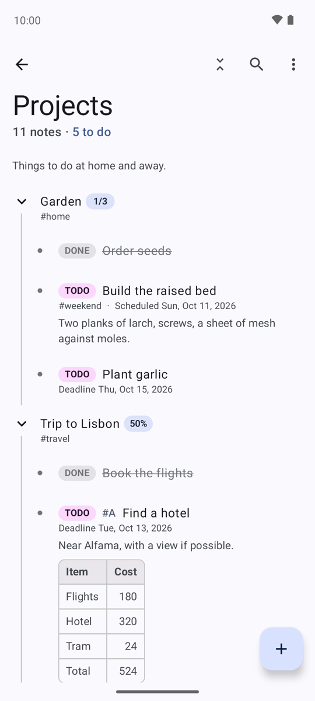
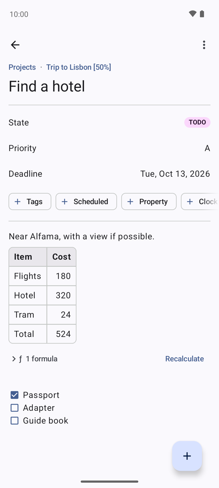
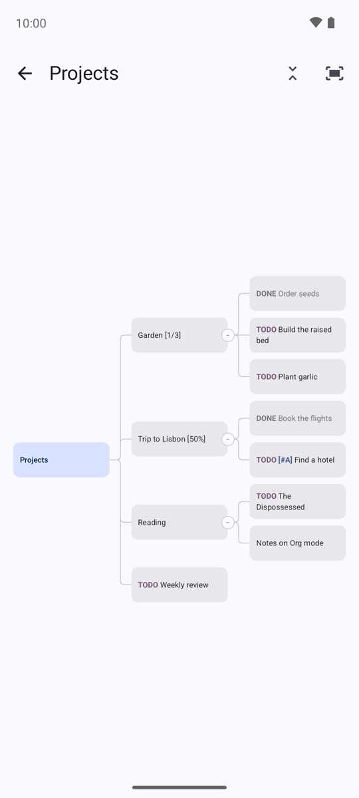
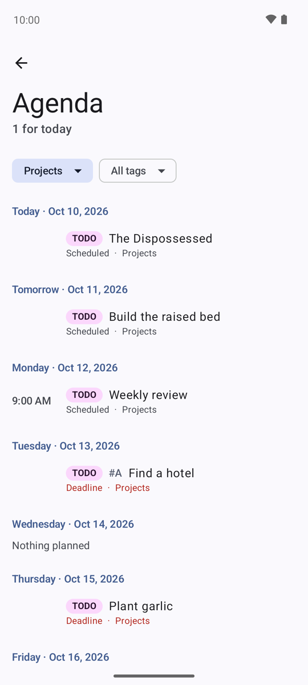

# Narwhal


An Android app for [Org mode](https://orgmode.org) notes, inspired by
[Orgzly](https://github.com/orgzly/orgzly-android).

<p>
  
  
  
  
</p>

## Features

- **Your `.org` files, nothing else.** Narwhal works on a folder you pick. Changes made elsewhere
  show up within seconds, and what Narwhal doesn't change stays as it was, so the same files open
  in Emacs.
- **Outline and tree.** Notebooks fold as in Org (`#+STARTUP`, `VISIBILITY`) and stay as you
  leave them; a tree view draws them as boxes to move around. Select notes to move, copy, archive
  or refile them.
- **Links.** `id:` links picked by title, internal links (`[[*Title]]`, `<<target>>`), and the
  notes linking back to each one.
- **Agenda and reminders.** The week ahead with repeating tasks, and exact reminders with Done and
  snooze buttons.
- **Org at hand.** Tables with formulas, checkboxes and `[/]` cookies, blocks and drawers,
  clocking, archiving, search with Orgzly's syntax, sharing from other apps.

## Download

Signed APKs are attached to each [release](https://github.com/yighy/narwhal/releases); see
[CHANGELOG.md](CHANGELOG.md) for what changed.

## Build

Requires JDK 17+ and the Android SDK (platform 37).

```bash
./gradlew :app:testDebugUnitTest :app:assembleDebug
```

Release builds are signed when a `keystore.properties` file at the project root (kept out of
git) gives `storeFile`, `storePassword`, `keyAlias` and `keyPassword`.

## License

GPLv3. Includes a copy of [org-java](https://github.com/orgzly/org-java) (GPLv3), see
[org-java/README.md](org-java/README.md).
